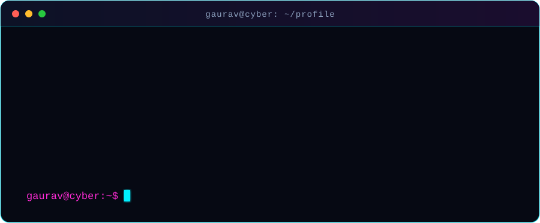
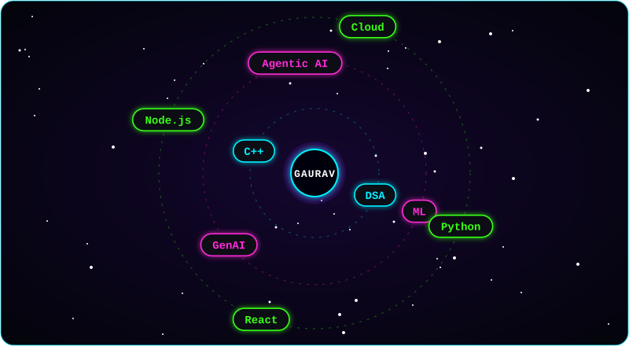
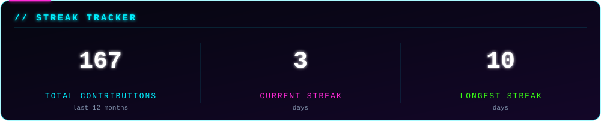
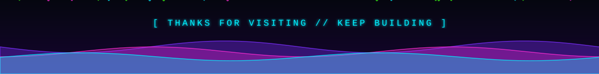

  

<h3>⟦ &nbsp;A B O U T &nbsp; M E&nbsp; ⟧</h3>

<h3>⟦ &nbsp;N E U R A L &nbsp; O R B I T&nbsp; ⟧</h3>

<h3>⟦ &nbsp;T E C H &nbsp; S T A C K&nbsp; ⟧</h3>

<b>[ LANGUAGES ]</b>  

  <b>[ FRONTEND ]</b>  

  <b>[ BACKEND ]</b>  

  <b>[ AI · DATA · VISION ]</b>  

  <b>[ DATABASES ]</b>  

  <b>[ CLOUD &amp; TOOLS ]</b>  

  

<h3>⟦ &nbsp;S Y S T E M &nbsp; S T A T S&nbsp; ⟧</h3>

  

  

  

  

  

